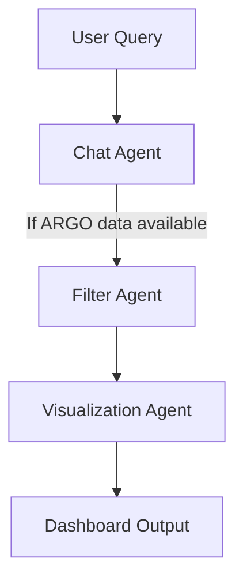

# 🌊 FloatChat — AGENTS.md

This document explains the **agents (functional modules)** in the FloatChat project and their roles in the pipeline.

---

## 🔹 1. Data Agent
**Role:** Ingests and prepares ARGO data.  
**Tasks:**
- Read ARGO NetCDF datasets.  
- Normalize column names (`time`, `latitude`, `longitude`, `temp`, `psal`, `pres`).  
- Convert raw NetCDF → **Parquet** for efficient access.  
- Cache data to improve performance.  

**Input:** NetCDF files.  
**Output:** Parquet DataFrames in `data_cache/`.  

---

## 🔹 2. Filter Agent
**Role:** Applies filters on data for user queries.  
**Tasks:**
- Geospatial subsetting (Indian Ocean vs world view).  
- Date range filtering.  
- Random sampling for faster plots.  

**Input:** Full DataFrame.  
**Output:** Filtered DataFrame.  

---

## 🔹 3. Visualization Agent
**Role:** Creates interactive dashboards.  
**Tasks:**
- **Plotly Maps** — scatter maps with ARGO floats.  
- **Leaflet Maps** — fast clustering, heatmaps.  
- **Cesium Globe** — 3D interactive globe.  
- **Profiles** — temperature vs depth, salinity vs depth, T–S diagrams, mean vertical sections.  
- **Tabular View** — previews data with paging.  
- **Export** — CSV, Excel, Parquet, NetCDF.  

**Input:** Filtered DataFrame.  
**Output:** Interactive visualizations.  

---

## 🔹 4. Chat Agent
**Role:** Conversational interface for ARGO queries.  
**Tasks:**
- Parse queries (`llm_parse_query`).  
- If dataset fields match → filter & plot results.  
- If no data available → **Hybrid Fallback**:  
  - DuckDuckGo search for snippets.  
  - Local LLaMA/Mistral via Ollama for reasoning.  
- Render chat history with Streamlit.  
- Show **example queries** from `example_queries.json`.  

**Input:** User queries.  
**Output:** Plots or AI-generated answers.  

---

## 🔹 5. Integration Agent
**Role:** Orchestrates all modules into the Streamlit app.  
**Tasks:**
- Manage **sidebar controls** (theme, filters, map styles).  
- Coordinate data → filter → viz → chat flow.  
- Handle caching, session state, and layout.  
- Provide **Final Judge-Ready Demo** via `dashboard.py`.  
    - Demo should include: seamless navigation, example queries, interactive maps, live data overlays, and clear instructions for judges.

---

## 🔹 6. External Data Agents (Live Layers)
**Role:** Fetch and overlay live external datasets.  
**Tasks:**
- Fetch **NOAA buoy data** (stations, locations).  
- Fetch **INCOIS demo mooring stations**.  
- Overlay stations on maps (Plotly + Leaflet).  

**Input:** External APIs.  
**Output:** Live layers on dashboard.  

---

## 🔹 Workflow

Mermaid source (for editing):

🔹 Notes

    Agents are modular and can be extended with other oceanographic datasets (gliders, moorings, satellites).

    Judges can test both data-driven plots and knowledge-driven answers.
